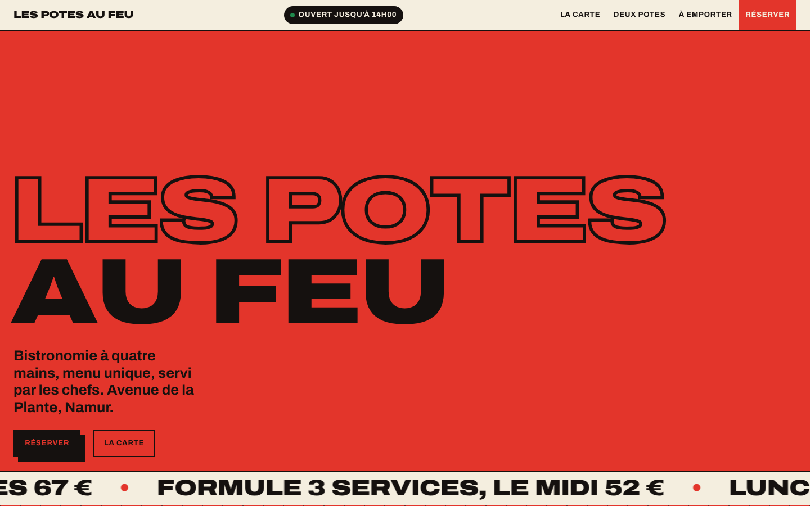

# Gabarit « Affiche »

**Pitch.** Chaque écran est une affiche de rue collée par-dessus la précédente : un aplat franc (rouge, jaune, vert,
crème), un titre énorme en Archivo extra-large, un bord dentelé, des horaires traités comme un titre principal et un
plat signature qui s'empile couche par couche au scroll.

## Pour qui

Pizzeria créative, street food et friterie, brasserie populaire, burger : des lieux joyeux, directs, avec une carte
courte et des horaires qu'on veut lire en une seconde. Ambiance criarde assumée ; à éviter pour une table
gastronomique feutrée.

## Pages et sections

| Page | Affiches (dans l'ordre) |
| --- | --- |
| Accueil | Hero rouge (nom contour + plein, pastille « ouvert jusqu'à », plat en lévitation, marquee de la carte) · Définition crème · « Ça s'empile » vert (scène épinglée, 5 couches, prix qui claque) · Carte bento crème · Horaires jaune (7 cartes, « aujourd'hui » tourné) · Comment ça marche rouge (sur place / à emporter, numéros qui se remplissent) · Galerie inclinée crème (bande épinglée, disque CTA rotatif) · Visite vert (plan schématique SVG) · Pied de page ink « À table ! » |
| Carte | Hero jaune · bento par catégorie (crème) · formules + menu du jour (vert) · CTA rouge |
| Deux potes (histoire) | Hero vert · récit + valeurs (crème) · équipe (jaune) · avis (rouge) · coulisses (crème) |
| Réserver | Hero rouge (Zenchef, téléphone, e-mail) · formulaire de démonstration (crème) · horaires (jaune) · visite (vert) |
| À emporter | Page entièrement illustrative : hero jaune · 3 étapes (rouge) · boîtes en bento (crème) · commander (vert) |
| 404 | Affiche rouge « Affiche arrachée » |

## Composants

- `Affiche.astro` : section d'une couleur (`tone`), dents SVG à la couleur de l'affiche précédente (`prev`), `plein` pour 100 svh.
- `Plat.astro` : le plat signature en 5 couches SVG (`data-couche="01..05"`) ; remplaçable par 5 `` détourées.
- `Bento.astro` : grille de plats sur aplats (nom, prix énorme, description en capitales, badges végé / épicé / signature / exemple).
- `Horaires.astro` : 7 cartes de jours, étiquette « aujourd'hui » posée côté client.
- `Disque.astro` : badge rotatif (textPath), ×3 au survol.
- `Header.astro` : en-tête crème fixe 56 px, pastille d'état calculée à l'heure du visiteur, menu mobile plein écran jaune.
- `Footer.astro` : mot d'adieu géant, colonnes, colophon, mention maquette, `KywFooter`.
- Motion : `motion/setup.ts` (rideau 4 bandes, transition « affiche qui descend ») et `motion/drivers.ts` (empile, galerie, marquee, claque, cercles, idle, disque, pastille, en-tête).

## Données exigées pour l'adaptation

- Nom sur deux lignes, baseline, adresse, téléphone, horaires par jour (créneaux), outil de réservation.
- 1 plat signature en 5 couches (noms + détails ; idéalement 5 PNG détourés) et son prix.
- 12 plats avec prix (bento), 3 formules, 1 menu du jour, 3 étapes « à emporter » si le service existe.
- 8 photos reportage (4:5 ou recadrables), une équipe de 3 à 4 personnes, 3 avis réels.
- Une définition humoristique du nom (ou retirer la section).

## Limites

- Les couches du plat sont dessinées (SVG) : pour un rendu photo il faut 5 détourages PNG.
- Le plan de la section Visite est schématique (SVG), pas une carte interactive.
- Le formulaire de réservation n'envoie rien : il ouvre l'outil réel.
- Contraste : sur rouge et vert, le texte est toujours grand ou gras (≥ 19 px / 700) ; ne pas y poser de paragraphe 17 px.
