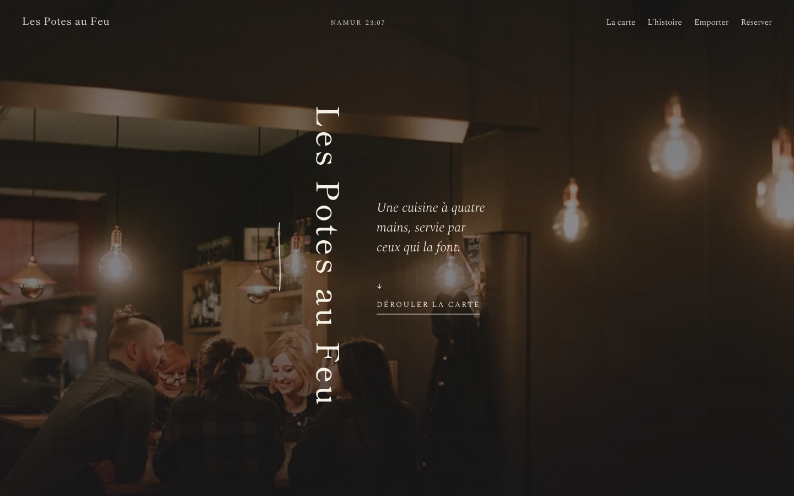

# FICHE — gabarit « Encre »

**Pitch.** Ivoire, encre et un sceau vermillon : la carte se déroule comme un rouleau peint, les titres se lisent à la
verticale et chaque section s'ouvre par un signe numéroté.

## Pour qui
Sushi et omakase, ramen et izakaya, table asiatique contemporaine ; plus largement toute table calme et précise qui
veut une carte courte mise en scène (12 plats au plus dans le rouleau). Restaurants cibles indicatifs du cahier :
ferme-blanche-d-asie, makimono, sanga.

## Pages
`/` (accueil), `/carte/` (carte réelle + rouleau complet en défilement horizontal), `/histoire/` (rencontre, lieu,
chefs et équipe, valeurs), `/reservation/` (Zenchef, téléphone, formulaire de démonstration, samedi et bons cadeaux,
plan d'accès), `/emporter/` (page d'exemple avec bandeau, sans réservation), `/404`.

## Sections de l'accueil
Hero plein écran (photo sombre peinte au premier rendu, nom vertical, phrase, invitation « Dérouler la carte ») ·
01 Concept (colonne de 420 px, citation du Guide MICHELIN) · 02 Le Rouleau (signature) · 03 L'histoire (diptyque 4:5,
titre vertical) · 04 Les chefs (portraits centrés) · 05 En images (quinconce) · 06 Venir (plan au trait, horaires,
réserver) · pied de page en diptyque décalé avec le sceau, puis pied de page KYW.

## Composants
- `Rouleau.astro` : bande horizontale de 12 plats. Desktop + motion : section épinglée, scrub, traits de pinceau SVG
  (`stroke-dashoffset`, masque SVG natif sur les photos), sceau qui se pose, barre de progression, flèches ← → au
  clavier. Mobile, page carte et reduced motion : défilement horizontal natif avec snap (80 vw par plat).
- `TitreV.astro` : titre vertical (`writing-mode: vertical-rl` ≥ 1024 px, horizontal en dessous), caractères qui
  s'allument au défilement (pierre → encre), nom accessible lisible d'un trait.
- `Sceau.astro` : seul cercle et seul rouge ; lien vers la réservation, rotation de 8° au survol.
- `Plan.astro` : plan d'accès au trait (Meuse, Citadelle, Casino, Royal Snail) tracé à l'entrée ; schéma sans échelle.
- `HeroPage.astro` : hero des pages intérieures (photo 960 px en mobile, préchargée, titre vertical).
- En-tête en `mix-blend-mode: difference` avec heure locale calculée ; loader ivoire à nom vertical ; rideau de page
  horizontal (le rouleau se referme puis s'ouvre).

## Jetons
Ivoire `#f6f1e6`, encre `#19171a`, vermillon `#c6341f`, pierre `#66605a` (texte doux, AA), lavis `#dcd6cb` ;
Shippori Mincho B1 500/700 (affichage) et Spectral 300/400 + italiques (texte), auto-hébergées ; radius 0 ;
`--silence` 120 à 200 px ; `--lane` 3,5 rem en desktop pour les titres verticaux.

## Données exigées pour adapter le gabarit
Nom, adresse, téléphone, horaires, outil de réservation ; 8 à 12 plats courts (nom, trois mots, prix) pour le
rouleau ; menu ou carte réelle ; 2 à 4 paragraphes d'histoire ; portraits des chefs ; 8 photos sombres et chaudes
(4:5 de préférence) ; repères d'accès (gare, parking, temps de marche) ; initiales pour le sceau ; e-mail de contact.

## Limites
- Le rouleau tient 12 plats au plus ; une carte longue passe par la page Carte.
- Le texte vertical est réservé aux titres de 1 à 4 mots.
- Le plan d'accès est un schéma à redessiner par restaurant (repères locaux).
- Aucun caractère japonais : les signes sont des numéros et des initiales.

## Données illustratives dans cette démonstration
Les 12 plats du rouleau (le restaurant de référence n'est pas asiatique), la carte des boissons, l'e-mail, le temps
de marche depuis la gare et le stationnement, les rôles de Sara et Jordan, la page « À emporter » entière. Chacune
porte sa marque à l'écran (« Exemple », « exemple », astérisque vermillon, bandeau).
