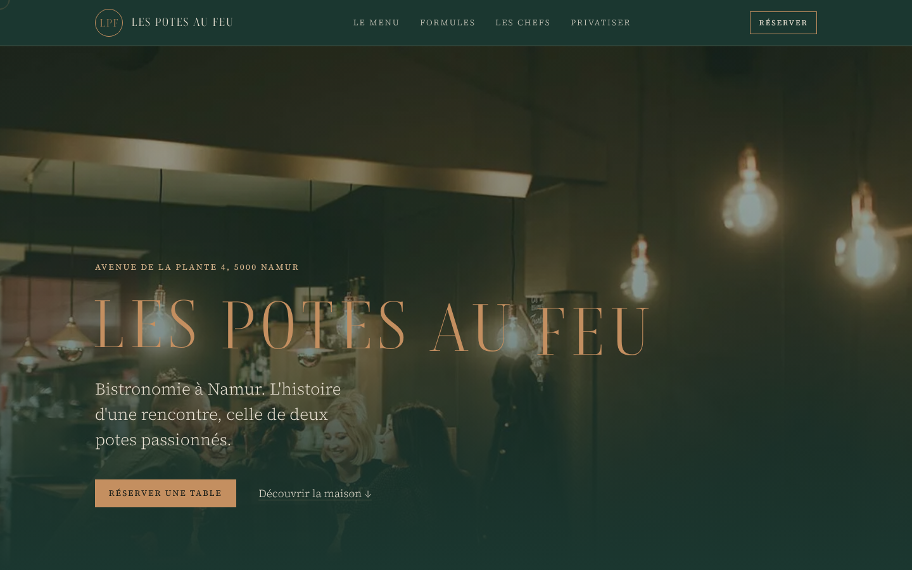

# FICHE — gabarit « Velours »

**Pour qui** : table gastronomique ou Gault&Millau, fine dining à menu unique, salle intime à peu de couverts. Une maison
qui a des nombres vrais à montrer (services du menu, prix unique, chefs, année d'ouverture, tables si connu).

**Ambiance** : feutré, précieux, contenu. Vert sapin, cuivre en aplat (jamais de dégradé), ivoire ; Boska en capitales et en
chiffres, Source Serif 4 au corps (17 px). Radius 0, seul le logo cerclé est rond. Aucune texture.

**Signature** : chaque chapitre se dévoile comme un rideau (pan vert sapin levé par clip-path, une fois, 1,1 s) sur un chiffre
cuivre monumental qui compte de 0 à sa valeur et se décale en parallaxe sur la photo. Loader et transitions de page sont
le même rideau.

## Pages et sections
- **Accueil** : hero (photo de salle, nom en capitales cuivre, accroche, Réserver, lien « Découvrir la maison ») · bande des
  guides (distinctions réelles seulement) · chapitre « 4 services » · chapitre « 67 euros » (inversé, filet pointillé) ·
  citation sur fond profond (mots qui s'allument au scrub) · chapitre « 2 chefs » (portrait N&B) · onglets du samedi
  (privatisation, mariage, chef à domicile : barre cuivre 6 s, photo de fond qui change) · galerie N&B (5 photos, hauteurs
  variées, scroll natif en mobile) · carte de clôture « 2020 » (adresse, 3 lignes d'horaires calculées, Réserver).
- **Le menu** (`/menu/`) : les services numérotés (mises en bouche et mignardise hors numéro), suppléments et options,
  triptyque de photos décalées.
- **Formules** (`/carte/`) : 3 prix monumentaux (67 / 52 / 40), bons cadeaux.
- **Les chefs** (`/histoire/`) : 2 portraits N&B, récit en 3 paragraphes, équipe de salle, valeurs.
- **Le samedi** (`/privatisation/`) : 3 offres alternées, contact par téléphone.
- **Réserver** (`/reservation/`) : Zenchef, téléphone, formulaire de démonstration (date minimale calculée), horaires, itinéraire.
- **404**.

## Composants
`Chapitre.astro` (rideau + chiffre + photo + texte, `inverse`, `filet`, `lien`), `HeroPage.astro` (filigrane du chiffre,
titre, chapô), onglets à barre (`[data-onglets]`, rôles ARIA tab/tabpanel, flèches clavier, pause au survol et au focus,
pas de rotation en reduced motion), citation `[data-allume]` (mots en spans posés au build), galerie N&B, carte de clôture,
en-tête collant opaque avec logo cerclé, pied de page profond + `KywFooter`.

## Données exigées pour adapter
- 3 à 4 **nombres vrais** avec leur preuve (`site.chiffres`) : services, prix, chefs, ouverture (ou tables, couverts, années).
  Sans nombre prouvé, le chapitre est retiré, jamais inventé.
- 6 photos sombres et chaudes (salle, plat, portrait) et 5 photos convertibles en N&B ; une citation sourcée (guide, presse,
  ou chef) ; les distinctions réelles (sinon la bande des guides est supprimée) ; le menu en services ; les horaires.

## Limites
- Les onglets du samedi affichent des textes d'offre illustratifs (marqués) tant que le client ne les écrit pas.
- Pas d'e-mail (inconnu) : le pied de page n'affiche que le téléphone. Le nombre de tables est inconnu : pas de chapitre
  « tables ».
- Site calme : aucun mouvement au repos hors les onglets (choix du cahier).
